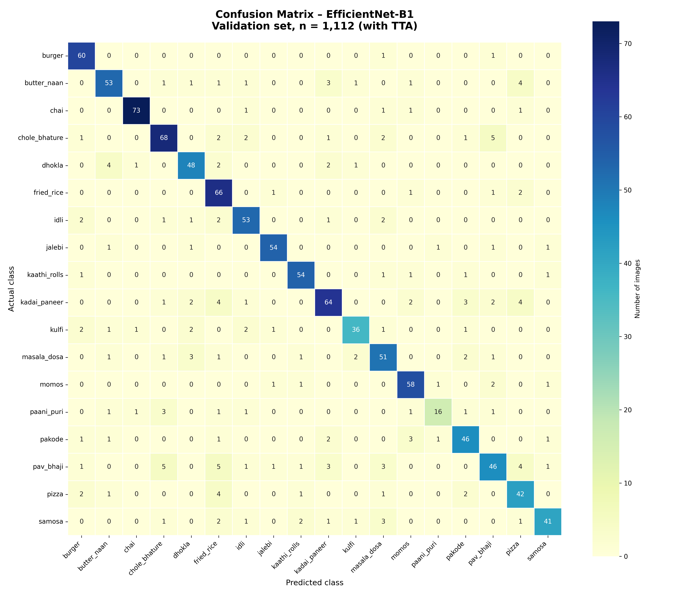
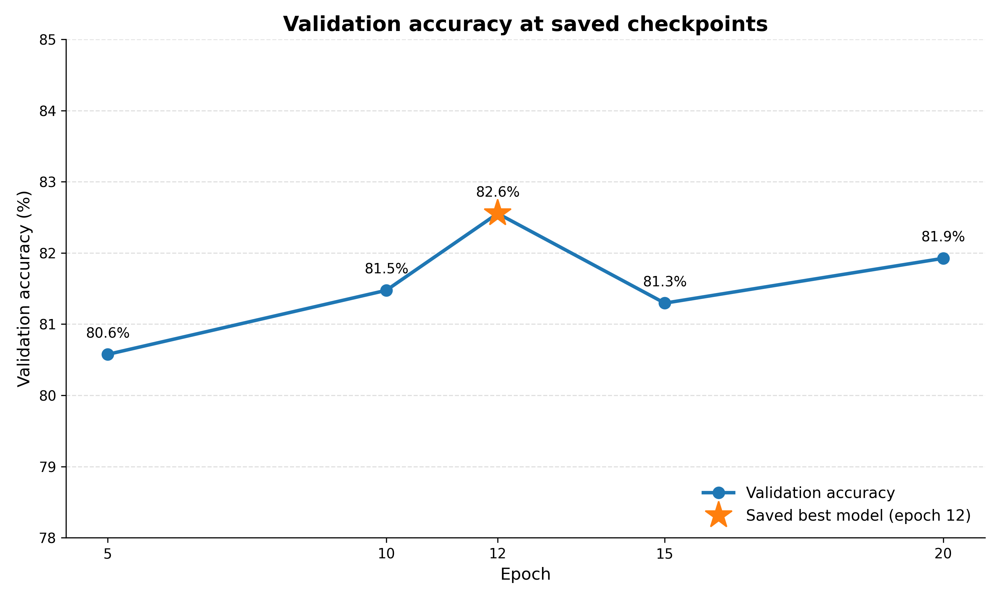
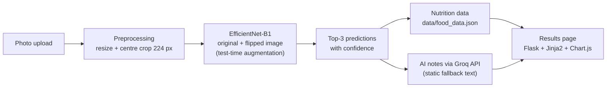
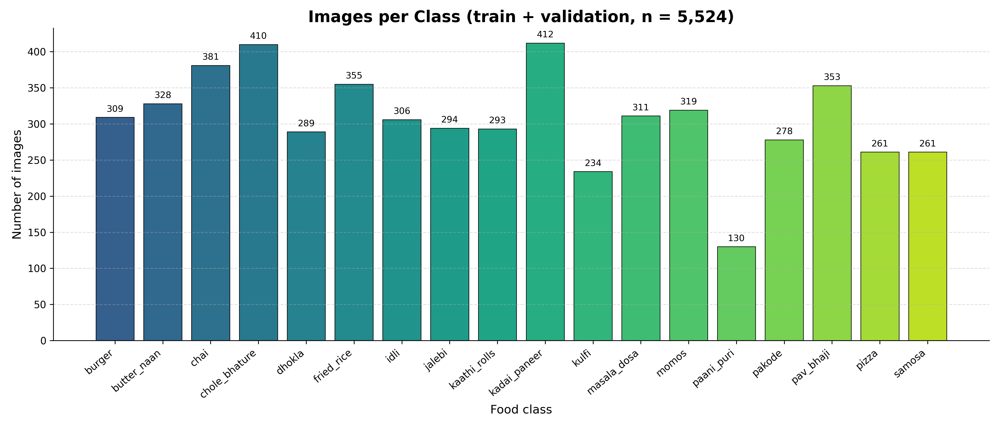

# NutriVision AI — Indian Food Recognition and Nutrition Analysis

A Flask web app that recognises 18 Indian dishes from a photo and turns the prediction into nutrition information: calories and macronutrients, a portion slider, activity needed to burn the calories, an eco score, and short AI-generated notes on the dish. The image classifier is an EfficientNet-B1 fine-tuned with PyTorch.

Individual project for the module Data Analytics 3: Deep Learning, MSc Applied Data Science and Analytics, SRH University of Applied Sciences Heidelberg (Hamburg campus), December 2025.

## At a glance

| | |
|---|---|
| **Task** | Image classification, 18 classes of Indian food |
| **Model** | EfficientNet-B1 pretrained on ImageNet; backbone frozen, new classification head trained |
| **Data** | 5,524 images: 4,412 training / 1,112 validation (stratified 80/20 split, seed 42) |
| **Result** | 83.5% top-1 and 93.3% top-3 accuracy, macro F1 0.83 on the 1,112 validation images (with test-time augmentation) |
| **Stack** | Python, PyTorch, torchvision, Albumentations, scikit-learn, Flask, Jinja2, Bootstrap, Chart.js, Groq API |
| **Status** | Runs locally; not deployed |

## Results

| Metric (validation set, n = 1,112) | Value |
|---|---|
| Top-1 accuracy | 83.54% |
| Top-3 accuracy | 93.26% |
| Macro precision / recall / F1 | 0.838 / 0.827 / 0.830 |
| Average prediction confidence | 0.76 |

These numbers come from `src/evaluate_model.py` using the app's inference pipeline with test-time augmentation; the raw output, including the full confusion matrix, is in `evaluation_results.json`. Without test-time augmentation, using the training pipeline, the saved model reaches 82.55% on the same images.

There is no separate test set: the validation images were also used to select the best training epoch, so these figures are likely slightly optimistic.





The model was trained for 20 epochs. Validation accuracy was already 80.6% after epoch 5 and peaked at 82.6% at epoch 12, which is the saved model (`results/checkpoint_val_accuracy.json`).

## How it works



1. **Classification.** The uploaded image is resized (shortest side 256 px) and centre-cropped to 224 × 224, so its aspect ratio is kept. The model predicts on the original and a horizontally flipped copy and averages the outputs. Predictions below 60% confidence are flagged in the interface, and the user can switch to one of the other top-3 classes.
2. **Nutrition.** Calories, protein, carbohydrates and fat per serving, eco score, dietary tags and burn-off activities come from a curated JSON file and are rescaled by the portion slider (0.5× to 3×).
3. **AI notes.** A Groq-hosted LLM writes a cultural note, a sustainability explanation, leftover ideas and short insights. If the API is unavailable, the app falls back to static text from the JSON file. Flavour pairings always come from the JSON file. The interface loads its JavaScript libraries and fonts from CDNs, so it needs an internet connection.

## Features

- Upload page and results dashboard with top-3 predictions and confidence
- Interactive macronutrient radar chart and portion slider (Chart.js)
- Switching to another top-3 class when the prediction is wrong
- Meal-time suggestions (breakfast, lunch, dinner) and burn-off estimates
- Eco score with a short sustainability explanation
- Demo page with precomputed predictions for five validation images

## Model and training

| Setting | Value |
|---|---|
| Architecture | torchvision `efficientnet_b1` (ImageNet weights); classifier replaced by Dropout(0.2) + Linear(1280 → 18) |
| Trainable parameters | Classification head only (backbone frozen) |
| Training augmentation | Random 90° rotation, horizontal flip, brightness/contrast (Albumentations), resize to 224 × 224 |
| Optimiser | Adam, learning rate 0.001, batch size 32, cross-entropy loss |
| Epochs | 20; best checkpoint by validation accuracy (epoch 12) |
| Inference | Resize + centre crop, test-time augmentation (original + horizontal flip) |

Note that training resizes images to 224 × 224 without keeping the aspect ratio, while inference keeps it and centre-crops. Together with test-time augmentation, this is why the accuracy with the app's inference pipeline (83.54%) differs slightly from the training-time validation accuracy (82.55%).

## Dataset

18 of the 20 classes of the Kaggle dataset [Indian Food Classification](https://www.kaggle.com/datasets/l33tc0d3r/indian-food-classification) (the classes chapati and dal_makhani were not used): burger, butter naan, chai, chole bhature, dhokla, fried rice, idli, jalebi, kaathi rolls, kadai paneer, kulfi, masala dosa, momos, paani puri, pakode, pav bhaji, pizza, samosa.



Classes range from 130 images (paani puri) to 412 (kadai paneer). The dataset is not included in this repository. The images in the dataset were collected from the web and their copyright is not documented; the five demo images in `static/demo_images/` are taken from the validation split.

## Getting started

### Prerequisites

- Python 3.9 or later
- Optional: a [Groq](https://console.groq.com) API key for the AI notes (without it, the static fallback text is shown)

### Installation

```bash
git clone https://github.com/samu2421/NutriVisionAI.git
cd NutriVisionAI
python3 -m venv venv
source venv/bin/activate
pip install -r requirements.txt
cp .env.example .env        # optional: add your GROQ_API_KEY
```

### Download the trained model

The trained weights (about 26 MB) are attached to the latest [release](https://github.com/samu2421/NutriVisionAI/releases):

```bash
curl -L -o models/efficientnet_b1_indian.pth \
  https://github.com/samu2421/NutriVisionAI/releases/latest/download/efficientnet_b1_indian.pth
```

### Run

```bash
python app.py
```

Open http://127.0.0.1:5001. The demo page (`/demo`) works without uploading an image.

### Reproduce training and evaluation

Download the Kaggle dataset, place one folder per class in `data/raw/`, then:

```bash
python -m src.train            # creates the 80/20 split in data/processed/ and trains
python -m src.evaluate_model   # writes evaluation_results.json
python scripts/export_checkpoint_metrics.py   # writes results/checkpoint_val_accuracy.json
```

`visualizations.ipynb` recreates the three charts from those files and the processed dataset.

## Repository structure

```
app.py                      Flask routes (upload, results, portion updates, correction, demo)
src/
  train.py                  Data split, training loop, checkpoints
  evaluate_model.py         Metrics and confusion matrix on the validation set
  predict.py                Inference with test-time augmentation
  genai_helper.py           Groq API calls with logging and fallbacks
  utils.py                  Nutrition data access, burn-off and eco score
  demo_config.py            Precomputed predictions for the demo page
data/food_data.json         Nutrition and food information for the 18 classes
templates/, static/         Jinja2 pages, CSS, JavaScript, demo images
scripts/                    Checkpoint metric export
results/                    Checkpoint validation accuracies (JSON)
visualizations.ipynb        Charts for this README
evaluation_results.json     Evaluation output
```

## Limitations

- One dish per photo; mixed plates are not supported.
- Portion size is not estimated from the image; the user sets it with the slider.
- Nutrition values are per standard serving from a manually compiled table, not measured.
- Accuracy is measured on images from the same web-collected dataset. Photos taken in other conditions (lighting, angle, clutter) are likely to score lower.
- No separate test set (see Results).
- The AI notes depend on an external API and model availability.

## Possible next steps

- Hold out a separate test set and fine-tune the last backbone blocks
- Use the same preprocessing for training and inference
- Multi-dish detection and visual portion estimation
- Containerise the app

## Credits

- Front-end template: [Restoran](https://htmlcodex.com) by HTML Codex (credit kept in the site footer)
- Dataset: [Indian Food Classification](https://www.kaggle.com/datasets/l33tc0d3r/indian-food-classification) on Kaggle
- Libraries: PyTorch, torchvision, Albumentations, Flask, Bootstrap, Chart.js, animate.css, WOW.js

## Author

Samiksha Dhere — individual project.